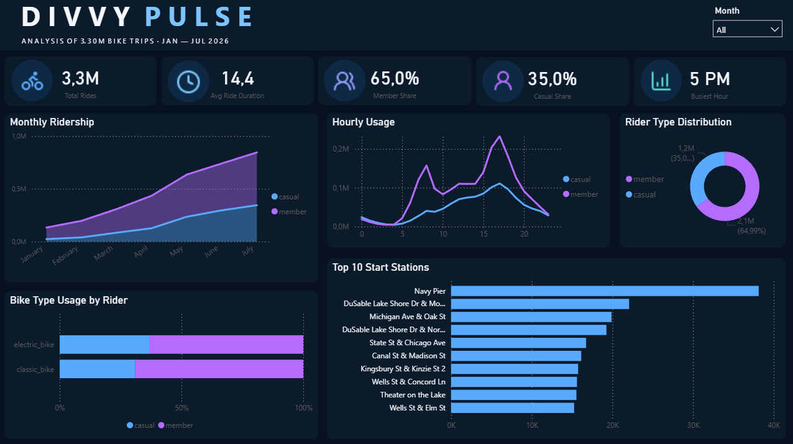

# divvy-bike-sharing-analysis
End-to-end analysis of 3.3M+ Divvy bike-sharing trips using Python, SQL and Power BI, with a focus on data quality, rider behaviour and operational insights.

# Divvy Bike Sharing Analysis

## Overview

This project analyses **3.3 million Divvy bike-sharing trips** recorded between **January and July 2026**.
The goal was to explore rider behaviour, identify usage patterns, compare casual riders with members, and present the results in an interactive **Power BI dashboard**.
The project covers the complete analytical workflow:
- Data exploration
- Data cleaning and validation
- Feature engineering
- SQL analysis
- KPI development
- Interactive dashboard creation

---

## Tools & Technologies
- **Python**
- **Pandas**
- **SQL**
- **DuckDB**
- **Power BI**
- **Power Query**
- **DAX**
- **Jupyter Notebook**
- **Git / GitHub**

---

## Dataset
The initial dataset contained:
- **3,389,831 trip records**
- **13 original columns**
- Divvy bike-sharing trips from **January to July 2026**
The monthly CSV files were combined into one dataset before cleaning and analysis.

---

## Data Cleaning
Data preparation was performed in Python using Pandas.
Main validation and cleaning steps included:
- Checking ride IDs for duplicates
- Validating date ranges
- Checking missing values
- Validating ride duration
- Identifying records outside the required analysis period
- Creating additional analytical features

### Cleaning Results
| Metric | Result |
|---|---:|
| Initial records | 3,389,831 |
| Final records | 3,297,649 |
| Records removed | ~92,000 |
| Records removed (%) | ~2.7% |
| Final number of columns | 21 |
The final dataset contained **3.30 million validated trips**.
Records with ride durations below **1 minute** or above **24 hours** were excluded from the analytical dataset.
Missing station information was retained where the ride itself remained valid, as removing these records would unnecessarily reduce the available behavioural data.

---

## Feature Engineering
Additional variables were created to support analysis:
- `start_date`
- `month`
- `month_name`
- `day_of_week`
- `day_of_week_num`
- `start_hour`
- `is_weekend`
- `ride_duration_min`
These fields were later used in SQL queries and Power BI visualisations.

---

## SQL Analysis
The cleaned dataset was analysed using **DuckDB SQL**.
The analysis focused on:
- Total ride volume
- Rider type distribution
- Average and median ride duration
- Monthly usage trends
- Weekday vs weekend behaviour
- Hourly usage patterns
- Bike type preferences
- Most frequently used start stations
- Popular station-to-station routes
- Round-trip behaviour

---

## Key Findings

### Rider Distribution
Approximately:
- **65% of trips were made by members**
- **35% were made by casual riders**
Members represented the majority of total Divvy usage during the analysed period.

### Ride Duration
Average ride duration:
- **Members:** ~12.2 minutes
- **Casual riders:** ~18.6 minutes
Casual riders generally took longer trips than members.

### Monthly Ridership
Ridership increased substantially from winter into summer:
- **January:** ~134K rides
- **April:** ~435K rides
- **July:** ~846K rides
July recorded the highest number of trips in the analysed period.

### Peak Usage
The overall busiest hour was approximately **5 PM**.
Members showed clear usage peaks around:
- **8 AM**
- **5 PM**
This pattern is consistent with commute-related usage.
Casual riders showed a more gradual increase throughout the day, with the highest activity occurring in the afternoon and early evening.

### Weekend Behaviour
Weekend trips accounted for approximately:
- **37% of casual rider trips**
- **23% of member trips**
Casual riders were therefore more active on weekends compared with members.

### Bike Type
Electric bikes were the most frequently used bike type by both rider groups.
Approximate electric-bike usage:
- **Casual riders:** ~73%
- **Members:** ~68%

### Round Trips
Casual riders were substantially more likely to return a bike to the same station where the trip started.
Round-trip share:
- **Casual riders:** ~7.9%
- **Members:** ~2.2%
Casual round trips were therefore approximately **3.6× more common** than member round trips.

### Most Popular Start Station
The most frequently used start station was:
**Navy Pier — approximately 38K trips**
Other high-traffic stations were concentrated around central Chicago and the lakefront.

---

## Power BI Dashboard

The final dashboard provides an interactive overview of Divvy usage.
It includes:
- Total Rides
- Average Ride Duration
- Member Share
- Casual Share
- Busiest Hour
- Monthly Ridership
- Hourly Usage
- Rider Type Distribution
- Bike Type Usage
- Top 10 Start Stations
- Month filtering


The dashboard was designed to provide a clear overview of rider behaviour while allowing users to explore key usage patterns interactively.

---

## Repository Structure

```text
divvy-bike-sharing-analysis/
│
├── data/
│   ├── raw/
│   └── processed/
│
├── notebooks/
│   ├── 01_data_exploration.ipynb
│   ├── 02_data_cleaning.ipynb
│   └── 03_sql_analysis.ipynb
│
├── images/
│   └── divvy_dashboard.png
│
├── powerbi/
│   └── divvy_dashboard.pbix
│
├── README.md
├── requirements.txt
└── .gitignore
```

The raw and processed datasets are excluded from the repository because of their size.

---

## Project Workflow

```text
Raw CSV Files
      ↓
Python / Pandas
      ↓
Data Cleaning & Validation
      ↓
Feature Engineering
      ↓
Clean Dataset
      ↓
SQL Analysis
      ↓
Power BI
      ↓
Interactive Dashboard & Business Insights
```

---

## Project Outcome
This project demonstrates practical experience with:
- Cleaning and validating multi-million-row datasets
- Analysing large datasets using SQL
- Identifying behavioural and operational trends
- Developing KPIs
- Building interactive Power BI dashboards
- Translating analytical results into clear business insights
```
